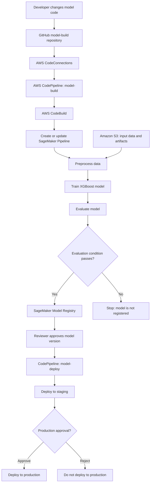

# Lab: Build an AWS MLOps CI/CD Pipeline with Amazon SageMaker Projects

**Duration:** 60–90 minutes  
**Level:** Beginner to Intermediate  
**Delivery mode:** Instructor-led demonstration with selected hands-on steps  
**AWS services:** Amazon SageMaker AI, SageMaker Projects, SageMaker Pipelines, SageMaker Model Registry, AWS CodePipeline, AWS CodeBuild, AWS CodeConnections, Amazon S3, AWS CloudFormation, Amazon EventBridge, GitHub

> **Lab approach:** This lab uses the AWS-provided SageMaker AI project template for **model building, training, and deployment with third-party Git repositories using CodePipeline**. It is the closest AWS-managed route to demonstrating an MLOps CI/CD pipeline builder. Use the current Amazon SageMaker Studio experience; do not start a new Studio Classic domain for this lab.

---

## 1. Business scenario

A seafood quality team wants to estimate the age of an abalone using measurements that are easier to collect than manually counting the rings in its shell.

The team wants an automated ML delivery workflow. Whenever a developer updates the model-building code and pushes the change to GitHub, AWS should:

1. Detect the source-code change.
2. Run the CI/CD build stage.
3. Create or update a SageMaker ML pipeline and execute it.
4. Preprocess the data, train the model, and evaluate its performance.
5. Register the model only when it passes the evaluation condition.
6. Allow an authorised reviewer to approve the model for deployment.
7. Deploy the approved model to staging and, after a separate approval, to production.

### ML problem

| Item | Description |
|---|---|
| Problem type | Regression |
| Prediction target | `Rings` |
| Business interpretation | Approximate age in years = `Rings + 1.5` |
| Input data | Physical measurements and sex of the abalone |
| Model in the sample | XGBoost regression |

### Dataset

Use the **UCI Abalone dataset**. It contains 4,177 rows, eight input features, and one target column. The input fields are `Sex`, `Length`, `Diameter`, `Height`, `Whole_weight`, `Shucked_weight`, `Viscera_weight`, and `Shell_weight`; `Rings` is the target.

- Dataset page: https://archive.ics.uci.edu/dataset/1/abalone
- AWS SageMaker sample pipeline guide: https://docs.aws.amazon.com/sagemaker/latest/dg/define-pipeline.html

The SageMaker project seed code is already designed for this dataset. For this demonstration, use the matching sample file from the AWS SageMaker seed-code S3 bucket rather than modifying the model's data schema.

---

## 2. What you will demonstrate

By the end of the session, participants should be able to explain and observe:

- How a SageMaker Project provisions a repeatable MLOps project structure.
- How GitHub and AWS CodeConnections provide source-control integration.
- How CodePipeline and CodeBuild automate the model-build workflow.
- How SageMaker Pipelines orchestrates preprocessing, training, evaluation, and conditional model registration.
- How SageMaker Model Registry manages model versions and approval status.
- How model approval can trigger deployment to staging, followed by a separate production approval.

### High-level architecture



**Explain the distinction:** CodePipeline handles source-driven CI/CD orchestration. SageMaker Pipelines handles the ML workflow itself. The Model Registry provides versioning and a governed approval point between model creation and deployment.

---

## 3. Time plan

| Time | Activity | Demonstration outcome |
|---:|---|---|
| 0–8 min | Introduce scenario and architecture | Participants understand the end-to-end flow |
| 8–18 min | Prepare the Abalone dataset in S3 | Correct input file is available at the expected S3 key |
| 18–28 min | Configure GitHub connection | AWS can access the two GitHub repositories |
| 28–40 min | Create the SageMaker Project | AWS provisions the sample MLOps resources and seeds the repositories |
| 40–50 min | Inspect the generated resources | Participants identify CodePipeline, CodeBuild, S3, SageMaker Pipeline, and Model Registry |
| 50–70 min | Trigger a CI/CD run with a Git commit | CodePipeline starts the ML pipeline and the model is trained and evaluated |
| 70–80 min | Inspect pipeline execution and model version | Participants see step status, evaluation, and model registration |
| 80–90 min | Demonstrate approval and deployment flow | Show staging approval and the production approval gate; deploy only if time and budget allow |

**For a 60-minute session:** Pre-create the GitHub connection and repositories, and pre-check that the Studio domain has project-template permissions. Prepare the dataset before the session. Use approximately 5 minutes for the scenario, 10 minutes for project creation, 5 minutes to inspect resources, 25 minutes for the code commit and ML pipeline run, and 15 minutes for Model Registry and the approval flow. Treat endpoint deployment as an architecture walkthrough.

---

## 4. Prerequisites and one-time setup

Complete these checks **before** the live demonstration. Creating a Studio domain and resolving IAM or Service Catalog permissions during a 60–90 minute session can consume the available time.

### 4.1 AWS account and SageMaker Studio

- An AWS account with permission to use Amazon SageMaker AI, Amazon S3, CodePipeline, CodeBuild, CodeConnections, CloudFormation, Service Catalog, and EventBridge.
- An Amazon SageMaker Studio domain and a user profile in the same AWS Region where you will run the project.
- Use the current **Amazon SageMaker Studio** experience. AWS documents that Studio Classic is no longer available for new onboarding.
- Keep all resources in one Region for this demonstration.

### 4.2 Enable SageMaker Project templates

Ask the AWS administrator to verify the following in the SageMaker AI console:

1. Open **Admin configurations → Domains**.
2. Select the Studio domain and open **Domain settings**.
3. Under **SageMaker Projects and JumpStart**, verify that these options are enabled:
   - Enable Amazon SageMaker AI project templates and Amazon SageMaker JumpStart for this account.
   - Enable Amazon SageMaker AI project templates and Amazon SageMaker JumpStart for Studio users.
4. In the Service Catalog console, open **Portfolios → Imported → Amazon SageMaker Solutions and ML Ops products → Access**.
5. Grant access to the domain execution role and any custom user-profile execution roles that will create projects.
6. Verify that the SageMaker Project service roles are available through the domain's Studio Settings workflow. Do not manually create these roles.

AWS lists additional Service Catalog product roles for project templates, including CodeBuild, CodePipeline, CloudFormation, and execution roles. A missing role or portfolio permission can cause project creation or pipeline execution to fail.

### 4.3 GitHub repositories

Create two **empty** GitHub repositories in an account or organisation you control:

| Repository | Purpose | Branch |
|---|---|---|
| `abalone-model-build-demo` | Model preprocessing, training, evaluation, and SageMaker Pipeline definition | `main` |
| `abalone-model-deploy-demo` | Staging and production deployment configuration | `main` |

The SageMaker project template populates these repositories with its starter code. Do not add unrelated files or a custom model implementation before project creation.

### 4.4 AWS CodeConnections connection

Create the GitHub connection before creating the SageMaker Project:

1. Open the **AWS CodePipeline** console.
2. In the navigation pane, open **Settings → Connections**.
3. Choose **Create connection**.
4. Select **GitHub** as the provider and enter a connection name, for example `sagemaker-github-demo`.
5. Choose **Connect to GitHub**. Install the AWS Connector for GitHub if prompted.
6. Select the GitHub account or organisation that owns the two repositories. Grant access to the two demo repositories (or all repositories, according to your organisation's policy).
7. Complete the connection and verify that its status is **Available**.
8. Add this tag to the connection:

   | Key | Value |
   |---|---|
   | `sagemaker` | `true` |

9. Copy the connection ARN. You will need it when creating the project.

---

## 5. Lab execution

### Step 1 — Prepare the dataset in Amazon S3 (8–18 min)

The sample pipeline expects this exact S3 object key in the SageMaker default bucket:

```text
s3://<SageMaker-default-bucket>/datasets/abalone-dataset.csv
```

The AWS seed-code bucket contains the matching sample file. Open a SageMaker Studio Jupyter notebook using an environment with the SageMaker Python SDK and `boto3` available, then run:

```python
import boto3
import sagemaker

region = boto3.Session().region_name
sagemaker_session = sagemaker.Session()
default_bucket = sagemaker_session.default_bucket()

source_bucket = f"sagemaker-servicecatalog-seedcode-{region}"
source_key = "dataset/abalone-dataset.csv"
target_key = "datasets/abalone-dataset.csv"

s3 = boto3.client("s3", region_name=region)
s3.download_file(source_bucket, source_key, "/tmp/abalone-dataset.csv")
s3.upload_file("/tmp/abalone-dataset.csv", default_bucket, target_key)

print(f"Dataset uploaded to: s3://{default_bucket}/{target_key}")
```

**Verify:** Open the Amazon S3 console, navigate to the SageMaker default bucket, and confirm that `datasets/abalone-dataset.csv` exists.

**Important:** The sample preprocessing code expects the dataset in the expected column order and without a header row. Use the AWS-provided sample file for this lab. Do not upload `abalone.names` as the training data.

### Step 2 — Create the SageMaker MLOps Project (28–40 min)

1. Open the **Amazon SageMaker AI** console and launch **Amazon SageMaker Studio**.
2. In the Studio navigation pane, choose **Deployments → Projects**.
3. Choose **Create project**.
4. In the template list, select the AWS-provided template with a name similar to:

   **Model building, training, and deployment with third-party Git repositories using CodePipeline**

   The exact label can vary slightly with the console experience and Region. Confirm that the template uses third-party Git repositories and CodePipeline.
5. Choose **Next**.
6. Enter project details:

   | Field | Example value |
   |---|---|
   | Project name | `abalone-mlops-demo` |
   | Description | `Abalone age prediction MLOps CI/CD demonstration` |

7. Under **ModelBuild CodeRepository Info**, enter:
   - **Branch:** `main`
   - **Full Repository Name:** `<github-user-or-org>/abalone-model-build-demo`
   - **Code Connection ARN:** the ARN copied in Step 4.4
8. Under **ModelDeploy CodeRepository Info**, enter:
   - **Branch:** `main`
   - **Full Repository Name:** `<github-user-or-org>/abalone-model-deploy-demo`
   - **Code Connection ARN:** the same CodeConnections ARN
9. Choose **Create project**.
10. Wait until the project appears in the Projects list with a created/available status.

**Explain while provisioning:** SageMaker Projects is the project-provisioning layer. The template uses Service Catalog and CloudFormation to create the AWS resources and seed the GitHub repositories with starter code.

### Step 3 — Inspect the provisioned resources (40–50 min)

Open the project details and show the associated resources. Also open the relevant AWS consoles in separate browser tabs.

| Resource | What to point out |
|---|---|
| GitHub model-build repository | Contains the SageMaker Pipeline definition and ML source code |
| GitHub model-deploy repository | Contains deployment configuration for staging and production |
| AWS CodePipeline | Orchestrates source and build stages for model building; a separate deployment pipeline handles deployment |
| AWS CodeBuild | Runs the build specification and invokes the SageMaker Pipeline creation/update and execution logic |
| Amazon S3 | Stores the training dataset, pipeline artifacts, model artifacts, and build artifacts |
| SageMaker Pipelines | Displays the ML workflow and its execution history |
| SageMaker Model Registry | Stores model versions and their approval status |
| CloudFormation | Provisions and manages the project infrastructure and deployment stacks |

Open **AWS CodePipeline → Pipelines** and identify the project pipelines. Pipeline names are generated from the project name and project ID; use the names displayed in your account rather than assuming a fixed ID.

### Step 4 — Trigger the CI/CD workflow with a Git commit (50–70 min)

1. Open the `abalone-model-build-demo` repository in GitHub.
2. Browse to `pipelines/abalone/pipeline.py`.
3. Find the `training_instance_type` parameter. In the AWS walkthrough seed code, its default is initially set to `ml.m5.xlarge`.
4. Change the default training instance type to `ml.m5.large`:

   ```python
   training_instance_type = ParameterString(
       name="TrainingInstanceType",
       default_value="ml.m5.large"
   )
   ```

   Preserve the existing formatting and surrounding code. If the generated repository has a different code layout, use the corresponding training-instance parameter in its `pipeline.py` file.
5. Commit the change to the configured `main` branch with a message such as:

   `Use smaller training instance for demo`

6. Open the model-build pipeline in **AWS CodePipeline**.
7. Refresh the execution view and observe the source and build stages.
8. Open the associated CodeBuild run and show its build logs.

**Explain the trigger:** The Git commit is the source-control event. CodePipeline retrieves the new revision, CodeBuild runs the build specification, and the build updates or creates the SageMaker Pipeline and starts an execution.

### Step 5 — Inspect the SageMaker ML pipeline (70–80 min)

In SageMaker Studio, open **Pipelines** and select the pipeline associated with the project. Open the latest execution and walk through the graph.

The Abalone sample workflow contains the following logical stages:

1. **Preprocess data** — prepares the raw records and creates training, validation, and test datasets.
2. **Train model** — trains an XGBoost regression model.
3. **Evaluate model** — evaluates the trained model and writes evaluation metrics.
4. **Condition check** — compares the evaluation metric against the configured threshold.
5. **Register model** — registers the model version when the evaluation condition passes.

In the sample seed code, the registration condition checks whether the evaluation mean squared error (MSE) is less than or equal to `6.0`. Treat this as a sample threshold for the lab, not as a universal production-quality target.

**Ask participants:**

- What is the difference between a CodeBuild job and a SageMaker Processing job?
- Why does the pipeline separate preprocessing, training, and evaluation?
- What happens if the evaluation condition fails?
- Why should the model start in `PendingManualApproval` rather than being deployed automatically?

**Validation checklist:**

- [ ] The CodePipeline source stage completed successfully.
- [ ] The CodePipeline build stage completed successfully.
- [ ] A SageMaker Pipeline execution was created.
- [ ] Preprocessing, training, and evaluation steps completed.
- [ ] The condition step outcome is visible.
- [ ] A model version appears in the Model Registry when the condition passes.

### Step 6 — Review and approve a model version (80–90 min)

1. In SageMaker Studio, open the project's **Model groups** or the **Model Registry** view.
2. Open the model package group created by the sample project.
3. Select the latest model version.
4. Review its evaluation metrics and confirm its current approval status.
5. For the deployment demonstration, choose **Update status** and change the status to **Approved**.
6. Open the model-deploy CodePipeline and observe the deployment workflow. The approved model is deployed to the staging environment.
7. If time and budget permit, open the deployment pipeline and demonstrate the manual approval gate between staging and production. Approve it only when you intend to create the production endpoint.

**Cost-conscious option:** Stop after showing the model version and the approval gate. You can explain the staging and production deployment stages using the pipeline view without provisioning a long-running SageMaker endpoint.

---

## 6. What the instructor should emphasise

| Concept | Explanation |
|---|---|
| CI for ML | Validates and packages model code and updates the repeatable ML workflow when source code changes |
| CD for ML | Moves an approved, versioned model through controlled deployment stages |
| SageMaker Pipelines | Orchestrates ML-specific steps such as processing, training, evaluation, and conditional registration |
| CodePipeline | Coordinates the source/build/deployment lifecycle around the ML pipeline |
| Model Registry | Provides model version history, metadata, metrics, and approval state |
| Human approval | Adds governance before a model is promoted to staging or production |
| S3 artifacts | Keeps input data, processed data, model artifacts, and pipeline/build artifacts available for repeatable runs |

### Suggested demo narrative

> “A data scientist updates the training code and pushes it to GitHub. CodePipeline detects the new revision and starts CodeBuild. CodeBuild updates the SageMaker ML pipeline and starts a new execution. SageMaker then preprocesses the data, trains and evaluates the model, and registers the model only if the quality condition passes. The model is not automatically promoted to production: a reviewer approves the version, the deployment pipeline moves it to staging, and a separate approval gate controls production deployment.”

---

## 7. Troubleshooting guide

| Symptom | What to check |
|---|---|
| MLOps template is not visible | Confirm the SageMaker Project template options are enabled for the account and Studio users. Check the domain execution role and Service Catalog portfolio access. |
| Project creation fails with an IAM or `AssumeRole` error | Ask the administrator to verify the SageMaker Project service roles and access to the **Amazon SageMaker Solutions and ML Ops products** Service Catalog portfolio. |
| GitHub connection is missing or unusable | Confirm that the connection is **Available**, that the GitHub App can access both repositories, and that the connection has tag `sagemaker=true`. |
| Repository seeding fails | Confirm the repositories exist, the account/organisation is authorised in the connection, and the specified branch is valid. |
| Pipeline fails while reading the dataset | Verify the object key is exactly `datasets/abalone-dataset.csv` in the SageMaker default bucket for the same Region. |
| Preprocessing fails due to malformed rows | Use the AWS seed-code Abalone file. It should be a headerless CSV with the expected nine fields in the expected order. |
| Resource creation fails with `AccessDenied` for tagging | The execution role's IAM policies must allow the required SageMaker resource-creation and tagging operations. |
| Model is not registered | Open the evaluation output and condition step. The model is registered only when the configured evaluation condition passes. |

---

## 8. Cleanup — do not skip

SageMaker processing/training jobs, endpoints, CodeBuild, storage, and other provisioned resources can incur charges. Clean up immediately after the demonstration.

1. If you created a staging or production SageMaker endpoint, delete it using the SageMaker console or the project's supported cleanup process.
2. In SageMaker Studio, open **Deployments → Projects**, select the demo project, and use **Delete**.
3. In CloudFormation, inspect the project-related stacks and confirm the staging and production deployment stacks are removed. If stacks remain, delete them after confirming they belong only to this demonstration.
4. Inspect Amazon S3 and remove the project artifact bucket and demo dataset object only if they are not used by another project.
5. Inspect CodePipeline and CodeBuild to confirm the project resources were removed.
6. Delete the two GitHub demo repositories if they were created only for this lab.
7. Keep the CodeConnections GitHub connection if you plan to reuse it; otherwise, remove it after confirming no other project depends on it.
8. Verify that no SageMaker endpoints or other billable demo resources remain.

Do not delete a shared SageMaker default bucket, shared connection, or domain as part of this lab cleanup.

---

## 9. Official references

- [Amazon SageMaker AI — MLOps automation with SageMaker Projects](https://docs.aws.amazon.com/sagemaker/latest/dg/sagemaker-projects.html)
- [Amazon SageMaker AI — MLOps project templates](https://docs.aws.amazon.com/sagemaker/latest/dg/sagemaker-projects-templates-sm.html)
- [Amazon SageMaker AI — Create an MLOps Project in Studio](https://docs.aws.amazon.com/sagemaker/latest/dg/sagemaker-projects-create.html)
- [Amazon SageMaker AI — Permissions required to use Project templates](https://docs.aws.amazon.com/sagemaker/latest/dg/sagemaker-projects-studio-updates.html)
- [Amazon SageMaker AI — Third-party Git and CodePipeline walkthrough](https://docs.aws.amazon.com/sagemaker/latest/dg/sagemaker-projects-walkthrough-3rdgit.html)
- [Amazon SageMaker AI — Define a pipeline and prepare the Abalone dataset](https://docs.aws.amazon.com/sagemaker/latest/dg/define-pipeline.html)
- [UCI Machine Learning Repository — Abalone dataset](https://archive.ics.uci.edu/dataset/1/abalone)

---

**End of lab**
